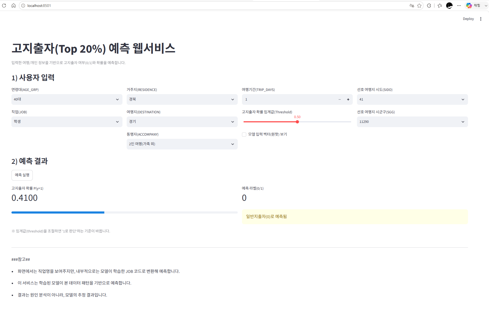

# AI Modeling Using Travel Data
AI Basic project

여행 소비 고지출자 예측 프로젝트

## [수행 단계]
1. 데이터 전처리
2. 범주형 변수에 대해 One-Hot Encoding 적용
3. 데이터를 Train / Validation / Test로 분리
4. 수치형 변수에 대해 StandardScaler를 적용
5. 로지스틱 회귀 모델을 학습하고 저장
6. FastAPI 기반 예측 API를 구현
7. Streamlit 기반 UI를 구성하여 예측 결과를 확인
